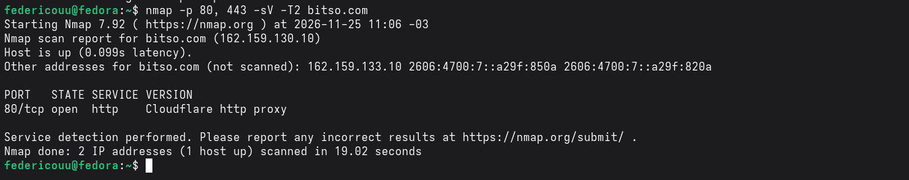

# Objetivo 2: Escaneo de Red (Nmap)

## Programa y Objetivo Autorizado (Bugcrowd)
* **Programa:** Bitso
* **Enlace al programa:** https://bugcrowd.com/bitso
* **Target seleccionado (In Scope):** `bitso.com`
* **Verificación de políticas:** Se verificó que `bitso.com` se encuentra dentro del alcance (*In Scope*) y que las reglas del programa no prohíben el escaneo ligero de puertos. Se empleó una velocidad baja (`-T2`) para respetar los límites de peticiones de la infraestructura.

## Comando Ejecutado
```bash
nmap -p 80, 443 -sV -T2 bitso.com
```


