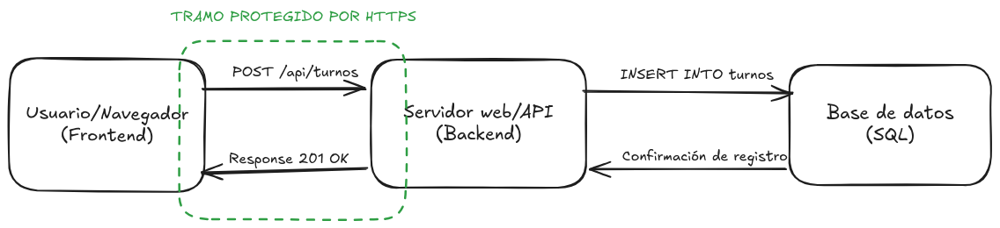

# Objetivo 1: Mapeo de Arquitectura Lógica

**Aplicación elegida:** Turnero (Software Seguro)

## Diagrama de Flujo

## Descripción del recorrido del dato
1. **Frontend:** El usuario completa los datos en el navegador y envía la petición.
2. **Protección HTTPS:** El viaje de ida y vuelta entre el navegador y el servidor ocurre cifrado bajo el protocolo **HTTPS (TLS)**, evitando intercepciones (MitM).
3. **Backend:** El servidor descifra la petición, valida los datos y procesa la lógica de negocio.
4. **Base de Datos:** El backend guarda o consulta la información en la base de datos mediante conexión interna.
