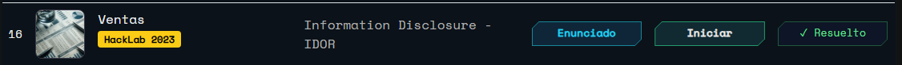
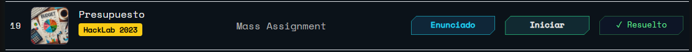
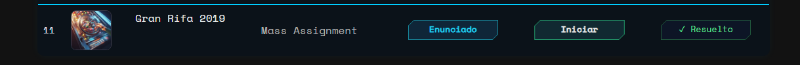

# Objetivo 2: Ejecución de Laboratorios

Informe con la resolución paso a paso de los laboratorios prácticos de la plataforma **Software Seguro**.

---

## 1. Laboratorio: Turnero
* **Pasos realizados:**
  1. Borrar un turno, y ver que aparece un id en el get
  2. Probar hasta encontrar el id del usuario deseado a borrar sus turnos el cual era el 101
  3. Borrar sus turnos los cuales tienen id con el metodo delete 
* **Evidencia / Resultado:**
* 

---

## 2. Laboratorio: Ventas
* **Pasos realizados:**
  1. En el endpoint GET modifico parametros y me doy cuenta que depende el numero de venta que ponga me da forbidden o not found
  2. En burpsuite tiro 3000 peticiones probando estos id de ventas y me fijo cuantos tienen el codigo 403 que es el forbidden
  3. Cuento cuantos forbidden hay, que eran 1641, los paso a MD5.
* **Evidencia / Resultado:**
* 

---

## 3. Laboratorio: Presupuesto

* **Pasos realizados:**
  1. Lo primero fue fijarse en el response del get para ver como se llamaba la variable de gastos y de los id, la cual se llamaba monto y id
  2. Luego apreté el boton revisar con el cual se ejecuta un post cuya url termina en /2/editar
  3. Ahi modifique con 3000 pesos extras a uno de los escenciales para obtener el promedio requerido 
  4. Luego se hizo lo mismo sumando 2000 pesos a un gasto vario para llegar al promedio requerido
  5. Y por ultimo se queria un promedio general menor al que habia, asique se restó 9500 pesos a gastos que no eran varios ni escenciales para llegaar a ese promedio
  6. Revisar todos los demas gastos.
* **Evidencia / Resultado:**
* 

---

## 4. Laboratorio: Gran Rifa 2019
* **Pasos realizados:**
  1. Aprete el boton editar y ahi me encuentro con el id y el esta_pago del usuario
  2. Busque el id de John en el get
  3. Modifico el esta_pago a true con el id
* **Evidencia / Resultado:**
* 
