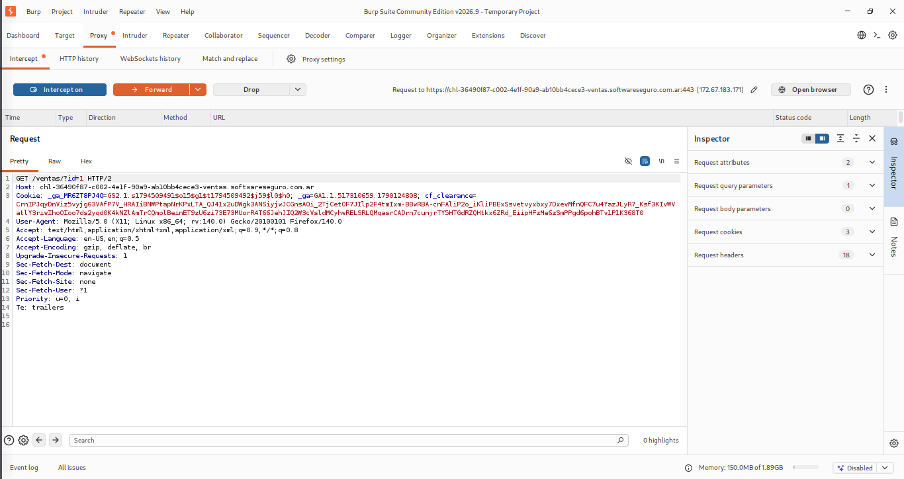

---

## ¿Qué es un Proxy?
Un **proxy** es un servidor o herramienta intermediaria que se ubica entre el cliente (el navegador web) y el servidor de destino. Todo el tráfico HTTP/HTTPS pasa primero por el proxy, lo que permite **inspeccionar, pausar, modificar y reenviar** peticiones y respuestas en tiempo real antes de que lleguen a su destino final.

---

## Diferencia entre un Proxy y una VPN
Mientras que un proxy actúa como intermediario únicamente para el tráfico de una aplicación específica (como el navegador) sin cifrar los datos por defecto, una VPN cifra todo el tráfico de red del dispositivo completo a través de un túnel seguro.

