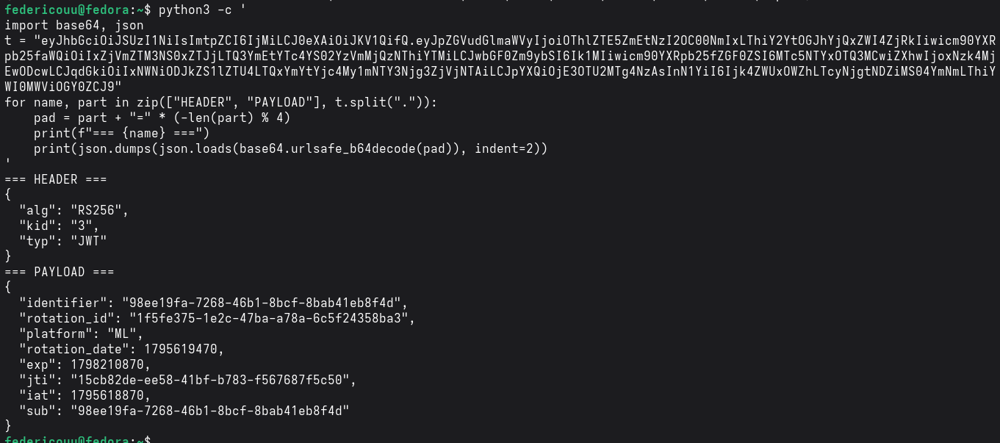

# Objetivo 2: Ingeniería Inversa a JSON Web Tokens (JWT)

Se extrajo un **JSON Web Token (JWT)** real desde la cookie `nsa_rotok` de **Mercado Libre** mediante el inspector del navegador (*DevTools > Storage > Cookies*) y se decodificaron localmente su cabecera (*Header*) y cuerpo (*Payload*) utilizando Python en terminal, manteniendo censurada la firma criptográfica (*Signature*).

---

## 1. Estructura Técnica del JWT Analizado

Un JWT se divide en tres segmentos codificados en **Base64URL** separados por puntos (`Header.Payload.Signature`):

* **Token (firma censurada):**
  `eyJhbGciOiJSUzI1NiIsImtpZCI6IjMiLCJ0eXAiOiJKV1QifQ.eyJpZGVudGlmaWVyIjoiOThlZTE5ZmEtNzI2OC00NmIxLThiY2YtOGJhYjQxZWI4ZjRkIiwi...<SIGNATURE_CENSURADA>`

---

### Header (Cabecera)
```json
{
  "alg": "RS256",
  "kid": "3",
  "typ": "JWT"
}
```
* **Algoritmo de firma (`alg`):** Utiliza **`RS256`** (*RSASSA-PKCS1-v1_5 using SHA-256*), un esquema de **criptografía asimétrica**. El servidor de autenticación firma el token con su clave privada y los distintos microservicios verifican su integridad usando la clave pública asociada al identificador de clave **`kid`: `"3"`** (*Key ID*). Esto impide que un atacante pueda generar o alterar tokens válidos sin poseer la clave privada del servidor.
* **Tipo (`typ`):** `"JWT"`, indica el formato estándar del token.

---

### Payload (Cuerpo / Claims en texto plano)
*(El Payload no está cifrado, únicamente codificado en Base64URL, por lo que su contenido es legible por cualquiera que intercepte el token).*

```json
{
  "identifier": "98ee19fa-7268-46b1-8bcf-8bab41eb8f4d",
  "rotation_id": "1f5fe375-1e2c-47ba-a78a-6c5f24358ba3",
  "platform": "ML",
  "rotation_date": 1795619470,
  "exp": 1798210870,
  "jti": "15cb82de-ee58-41bf-b783-f567687f5c50",
  "iat": 1795618870,
  "sub": "98ee19fa-7268-46b1-8bcf-8bab41eb8f4d"
}
```

* **Análisis de los datos expuestos en texto plano:**
  * **No expone credenciales ni PII directa:** Por buenas prácticas de diseño, Mercado Libre no incluye correos electrónicos, contraseñas ni roles administrativos explícitos en este token, sino identificadores aleatorios en formato **UUID v4**.

---

## 2. Evidencia de Decodificación en Terminal

