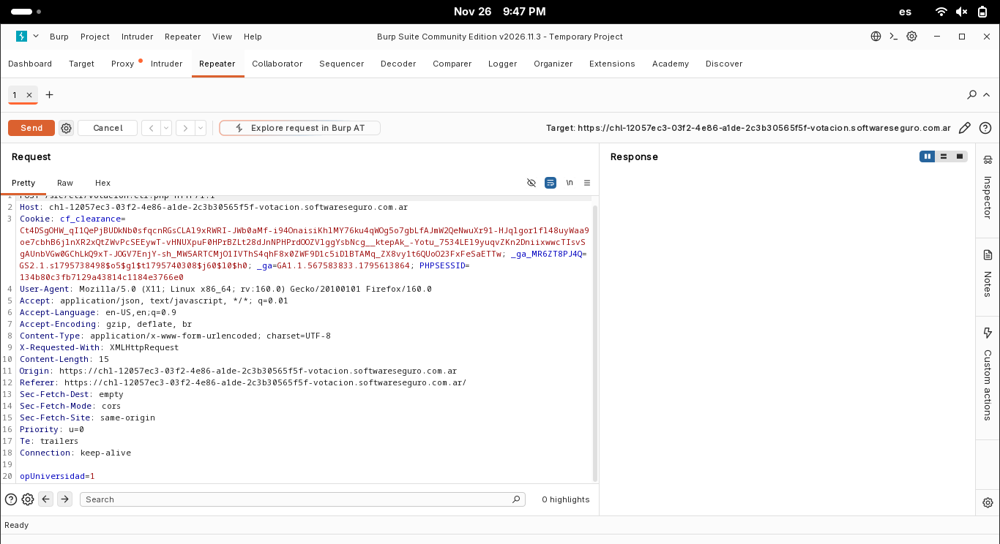
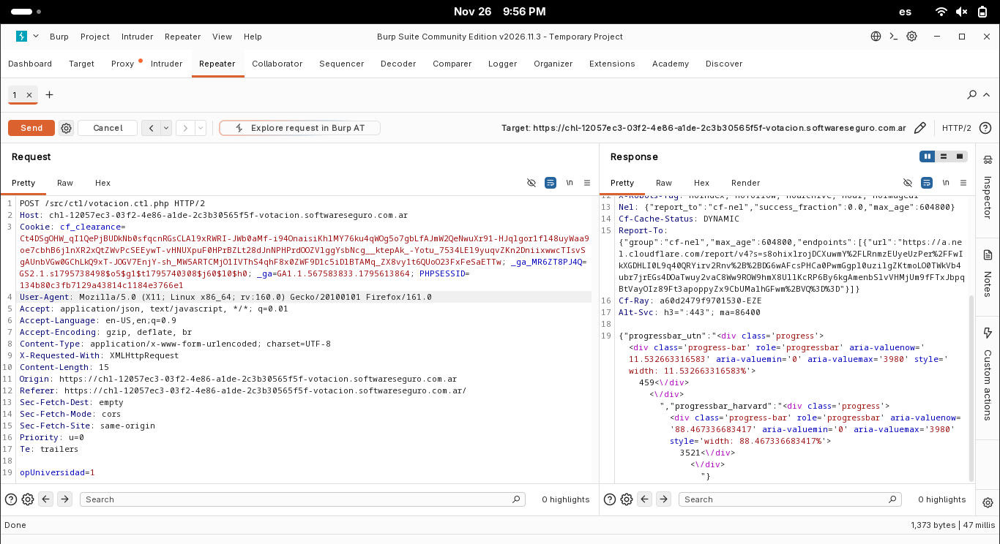

### Desarrollo de la Prueba

1. **Envío al Repeater y petición original:**
   Se envió la petición `POST /src/ctl/votacion.ctl.php` dirigida al host `chl-12057ec3-03f2-4e86-a1de-2c3b30565f5f-votacion.softwareseguro.com.ar` hacia la pestaña **Repeater**. En su estado original, la petición incluía las siguientes cabeceras y cuerpo:
   * **User-Agent:** `Mozilla/5.0 (X11; Linux x86_64; rv:160.0) Gecko/20100101 Firefox/160.0`
   * **Connection:** `keep-alive`
   * **Cuerpo (Body):** `opUniversidad=1`

   

2. **Modificación manual y reenvío:**
   Dentro del panel **Request** de Repeater, se realizaron modificaciones manuales sobre la petición antes de presionar **Send**:
   * Se alteró la cabecera `User-Agent` cambiando la versión del navegador de `Firefox/160.0` a `Firefox/161.0` (`rv:160.0` -> `rv:161.0`).
   * Se eliminó la cabecera `Connection: keep-alive`

3. **Respuesta obtenida del servidor:**
   Al enviar la petición modificada, el servidor procesó la solicitud mediante HTTP/2 y devolvió una respuesta exitosa (`Cf-Cache-Status: DYNAMIC`) con contenido en formato JSON/HTML indicando el estado de las barras de progreso de la votación (`progressbar_utn` con `450` votos y `progressbar_harvard` con `3521` votos)

   
